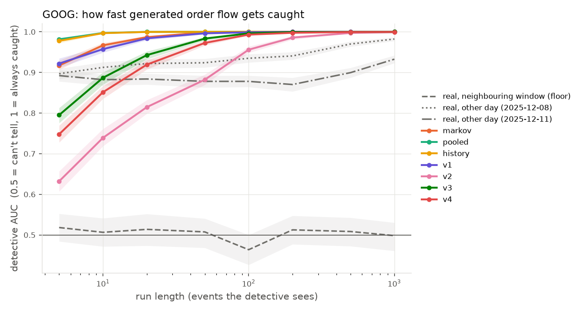
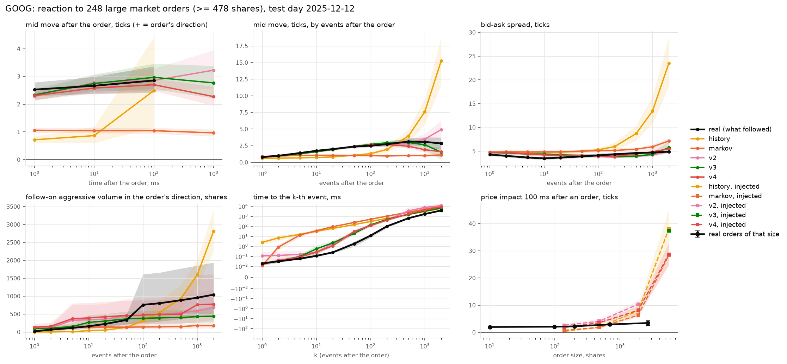

# lobgen

Can a model generate stock order flow that looks real? And if it can't, how long does it take
before you can tell?

That's the question this project tries to answer. I rebuilt the full order books for GOOG and
INTC from Nasdaq's raw TotalView-ITCH feed (five trading days in December 2025), trained
transformer models to continue the order flow one event at a time, and then measured how many
generated events it takes before a classifier spots the fake.

The idea came from Jane Street's post
[*Can you use autoregressive diffusion to generate market data?*](https://blog.janestreet.com/can-you-use-autoregressive-diffusion-to-generate-market-data/)
(September 2026). Their realism numbers are for one generated event at a time. They show longer
rollouts as plots and note that quality degrades further out, but don't put a number on how
fast. I wanted to measure exactly that.

This is still a work in progress. The data pipeline, the evaluation and the v2 model are
finished and reproducible. My two follow-up models (v3 and v4) made things worse, and working
out why is what I'm doing now (see [What I'm working on](#what-im-working-on)).

## What I found

The test is simple. I pick a moment in the real trading day, let a generator continue the order
flow from there, and ask a gradient-boosted classifier (the "detective") to tell the generated
continuation from what really happened. I report its AUC: 0.5 means it can't tell them apart,
1.0 means it always can.

- Before any of that, the plumbing had to be exact. I convert the raw messages into actions for
  an order-level simulator and decode them back, and all 45.3M messages and book rows across
  the 10 stock-days come out identical, apart from 44 sub-dollar stub quotes that sit off the
  tick grid (`results/sim_replay.json`).
- The test itself behaves. Two real stretches of the same day, about 20 seconds apart, score
  around 0.5.
- Every trading day has its own character. Real data from a different day at the same time of
  day is caught with AUC 0.89–0.94 after just 5 events. In those first events on the Friday,
  79% of GOOG's new orders were exactly 100 shares; on the Monday it was 34%. So a generator
  has to work out what kind of day it's in.
- Simple statistical baselines get caught almost straight away (AUC 0.90–0.98 after 5 events).
  My best model, v2, starts at 0.63 on GOOG and 0.70 on INTC, and only passes 0.9 after about
  59 and 41 events. Much better, but still caught.
- When a large market order hits, v2 moves the price about as much as the real market does:
  within 10% at 1, 10 and 100 ms on GOOG, while the baselines mostly stay near the 1-tick
  mechanical move. It's far too slow, though. The real market prints its next 100 events in
  12 ms and v2 takes 142 ms, and v2 misses the follow-up orders traders send after a big trade.
- A model 2.4 times bigger did no better than v2.
- My next two ideas didn't work. v3 adds a memory of recent order flow, and v4 adds the market
  itself (QQQ and SMH quotes, the closest thing to a news input I could build from the same
  feed). Both predict the next event as well as v2 but drift faster over longer runs, and v4
  mostly ignores the market.



*Test day Friday 2025-12-12: 1000 windows spread over the day, each continued for 1000 events
from the real book. Shaded bands are 95% bootstrap intervals over windows. INTC:
[results/detective_INTC.png](results/detective_INTC.png).*

Detective AUC after 5, 20 and 50 events. "Caught by" is the run length where AUC reaches 0.9
(`scripts/results_table.py`; confidence intervals and all lengths are in the
[full tables](#full-detective-tables)).

| generator | GOOG 5 events | 20 | 50 | caught by | INTC 5 events | 20 | 50 | caught by |
|---|---|---|---|---|---|---|---|---|
| real, neighbouring window (floor) | 0.52 | 0.51 | 0.51 | >1000 | 0.51 | 0.45 | 0.57 | >1000 |
| real, other day (Thu) | 0.89 | 0.88 | 0.88 | 505 | 0.94 | 0.97 | 0.98 | <5 |
| best baseline (Markov) | 0.92 | 0.99 | 1.00 | <5 | 0.90 | 0.99 | 1.00 | 5 |
| v1 | 0.92 | 0.98 | 1.00 | <5 | 0.77 | 0.88 | 0.95 | 26 |
| **v2** | **0.63** | **0.81** | **0.88** | **59** | **0.70** | **0.84** | **0.92** | **41** |
| full (2.4× v2's size) | 0.63 | 0.79 | 0.89 | 56 | 0.69 | 0.83 | 0.93 | 39 |
| v3 (v2 + order-flow memory) | 0.80 | 0.94 | 0.98 | 12 | 0.72 | 0.88 | 0.95 | 26 |
| v4 (v3 + market inputs) | 0.75 | 0.92 | 0.97 | 16 | 0.72 | 0.87 | 0.94 | 30 |

The models. All were trained for 20k steps (batch 64) on Monday to Wednesday of both stocks and
validated on Thursday.

| model | what's new | parameters | validation loss (nats/event) |
|---|---|---|---|
| v1 | first version, cancels addressed by (level, queue position) | 2.2M | 14.58 (different encoding, not comparable) |
| v2 | cancels can point at "my k-th newest order", plus a summary of the day so far ([why](#what-didnt-work)) | 2.2M | 13.77 |
| full | v2, bigger: d_model 256, 6 layers, 256-event context | 5.3M | 13.60 |
| v3 | v2 plus a memory of recent trades (direction and size over the last 8/64/512 trades, time since the last trade, mid vs its averages) | 2.2M | 13.74 |
| v4 | v3 plus how the stock, QQQ and SMH have moved in clock time | 2.2M | 13.73 |

I trained v1 on my laptop (Apple M5, about an hour) and the rest on a Colab GPU (about 30
minutes each for v2–v4, 2.2 hours for full).

## What I'm working on

**Why v3 and v4 drift.** Their one-step loss matches v2's, and I've checked that the inputs the
model sees while generating are exactly the ones it was trained on, so it's not a plumbing bug.
The detective catches them on the timing between events. My guess is that the new inputs
summarise the model's own recent output, so a small mistake gets fed back in and grows. Next I
want to run my rollout diagnostics (`scripts/diagnose_rollout.py`) on v3 and try training on
the model's own generated sequences.

**Getting v4 to actually use the market.** A plain linear beta to QQQ and SMH, fitted on the
training days, explains about 45% of the variance of GOOG's 10-second moves on the test day
(correlation 0.68 over 80 windows). v4's moves correlate just 0.16 with the real ones, about the
same as when I freeze the market (0.14). If I push the market down 50 bp, v4's GOOG drops 11 bp,
where the real beta says it should be closer to 58. I suspect that training on one event at a
time gives the model little reason to care about something that plays out over seconds, so I
want to try a loss that looks further ahead.

### To-do

Roughly the order I plan to work in:

- [ ] Run `scripts/diagnose_rollout.py` on v3 and v4 and find the point where their event timing
      starts drifting away from v2's.
- [ ] Fine-tune v3/v4 on their own generated sequences, so they learn to recover from their own
      small mistakes instead of compounding them.
- [ ] Add a loss that looks a few seconds ahead (for example, predict the mid move over the next
      10 s), then re-run the market test to see whether v4 starts following QQQ and SMH.
- [ ] Speed up the reaction after big trades. Real GOOG prints its next 100 events in 12 ms;
      my models take 119-142 ms.
- [ ] Model the meta-order: after a large trade, real aggressive flow keeps coming in the same
      direction for thousands of events, and my models stop after one.
- [ ] Train three seeds per model so the tables have error bars. Right now every number comes
      from a single training run.
- [ ] Run the ablations (no atoms, no book, short context, no day-so-far inputs) to see which
      parts of the model actually matter.
- [ ] Add more stocks and days, including a less liquid name and a different month.
- [ ] Score the models with LOB-Bench so the results can be compared with published work.

## How it works

### 1. Data

Free Nasdaq TotalView-ITCH 5.0 full-day files (`emi.nasdaq.com/ITCH/Nasdaq ITCH/`), converted to
LOBSTER format by this repo — same raw feed LOBSTER is built from, own conversion.
Core set: GOOG and INTC, 2025-12-08 .. 2025-12-12 (train Mon-Wed, validate Thu, test Fri):
47M events, 0 invariant violations.

```bash
uv sync
# fetch + filter (raw days are 4-18 GB; notebooks/fetch_itch_colab.ipynb does it in Colab)
uv run lobgen filter data/raw/S121225-v50.txt.gz --tickers GOOG INTC --out data/filtered/2025-12-12.itch
uv run lobgen convert data/filtered/2025-12-12.itch.gz --ticker GOOG --date 2025-12-12
uv run lobgen validate data/lobster/GOOG_2025-12-12_34200000_57600000_10.npz
```

Conversion choices (hidden-execution direction, `C` executions, replaces, crosses, halts) are
documented at the top of `src/lobgen/lobster.py`.

### 2. Simulator — `src/lobgen/sim.py`

Generators never write LOBSTER rows. They emit **actions relative to the current book**, and an
order-level simulator (one FIFO queue per price) turns each action into the message row and
book snapshot it causes. So every generator's output is a proper book by construction: never
crossed, no cancel of a missing order, volumes that add up.

| field | meaning |
|---|---|
| `dt` | ns since the previous event |
| `type`, `side` | LOBSTER type 1-5 (submit, partial cancel, delete, execution, hidden execution) |
| `price` | submit: ticks from own-side best (negative = inside the spread); cancel / delete / execution: index of an *existing* level (so it can never point at an empty price); cancel / delete: a negative value −(r+1) is a **pointer** to the r-th newest live order on that side (used for the 16 newest); hidden: half-ticks |
| `qpos` | which order in the level's queue: from the back for cancels and deletes, from the front for executions (0 is the mode for every type: 52-90% of cancels hit the newest order, 93-99% of executions the oldest) |
| `size` | shares (a delete removes the whole order); for an execution, **0 = the whole resting order** (78-79% of executions) |

Two codes exist because of what the first model got wrong ([What didn't work](#what-didnt-work)).
Real deletes are aimed at specific recent orders. Executions mostly consume the resting order
whole, and a generator cannot see that order's size. With the pointer, 85-88% of GOOG
cancels/deletes and 67-78% of INTC's are written as "the k-th newest order". The decode is
still exact on every row (`--pointer 0 --no-whole-fill` rebuilds the v1 encoding).

Invalid actions are repaired and counted (a crossing submit moves one tick inside the opposite
best, an out-of-range level or queue index is clipped), so the repair rate is itself a measure
of how well a model has learned the book's rules.

**Correctness check:** every converted day is encoded into actions and decoded back with fresh
order ids. Across all 10 ticker-days (45.3M rows) the decode reproduces every message and every
10-level book row exactly; the only inexact rows are 44 sub-dollar stub quotes (e.g. a $0.0001
bid) that are not on the tick grid (`results/sim_replay.json`, `scripts/build_actions.py`).
The order book at 09:30 (pre-open orders) is rebuilt from the ITCH stream for this.

### 3. Baselines — `src/lobgen/baselines.py`

The "clearly bad" end of the scale; all drive the simulator.

* **history** — each event is a random draw from the window's own 500 context events.
* **pooled** — each event is a random draw from all events of the training days.
* **markov** — first-order Markov chain over a 40-class summary of the previous event
  (type × side × price bucket); all fields of the next event are drawn jointly from a training
  event that followed the same class (keeps replace pairs: delete → submit in the same ns).

### 4. The detective — `src/lobgen/detective.py`

A classifier two-sample test, run separately at each run length L (5 … 1000 events): cut every
real and generated continuation to its first L events, summarise it with ~70 relative features
(event mix, inter-arrival times and zero gaps, sizes and round lots, prices vs the book, spread /
depth / imbalance, mid-price path, replace pairs, cancels of orders born inside the run, time to
delete), and score gradient-boosted trees by 5-fold cross-validation **grouped by window**, with
95% bootstrap intervals over windows. No absolute prices, no order-id values, and no context:
the detective sees only the continuation.

Two reference lines, both real data, set the scale:

* **real, neighbouring window (floor)** — real runs from adjacent windows of the same day
  (~20 s apart). What a perfect conditional generator would score. Comes out at AUC ≈ 0.5,
  which also checks the detective pipeline for leakage.
* **real, other day** — the real run from Mon or Thu at the same time of day: a generator that
  knows "a typical day" but not *this* day.
* (**replay** — the real run re-played through the simulator: exactly 0.5 by construction, a
  check that simulator output and order-id renumbering leak nothing.)

### 5. Model — `src/lobgen/model.py`

A causal transformer over simulator actions. Input token = the applied action + the book after
it (spread, 10 levels of volume and price gaps, imbalance, mid move, time of day) — all relative,
so one model serves both stocks. Output for the next event is factorised
`(type, side) → price → queue position → size → dt`, each field conditioned on those before it.

**Day-so-far inputs** (`src/lobgen/features.py`). GOOG prints about 400 events a second, so a
256-event context is about 0.6 s of history, far too short to tell what kind of day it is.
Every token therefore also carries exponentially weighted means over the day so far, at
half-lives of 2,000 and 100,000 events, of 14 per-event quantities:
- event mix
- 100-lot and round-lot share
- sizes and gaps
- pointer cancels
- spread and mid moves

They are causal and computed from the open. A generated run continues the same stream, and a
test checks that rollout inputs equal the training features of that stream exactly.
`--no-regime` removes them for the ablation.

**Spike-aware heads.** Order-flow fields are full of point masses: 17-32% of gaps are exactly
0 ns, 40-78% of submits are exactly 100 shares, most prices sit exactly at the touch. One generic
head handles every integer field: a mixture of **atoms** (every value holding ≥ 0.5% of the
training data, found automatically) and a **discretised mixture of logistics** on
sign(x)·log(1+|x|), integrated over each integer's bin so the likelihood is exact from 1 ns to
minutes. Nothing is designed per field. The atom rule found things nobody would hand-code, e.g.
price spikes ~287-320 and ~588 ticks from the touch (standing quotes far from the market).
`--no-atoms` removes them for the ablation.

```bash
uv run --group model python scripts/train.py --out checkpoints/full.pt       # or notebooks/train_colab.ipynb
uv run --group bench --group model python scripts/run_detective.py --only full --model checkpoints/full.pt --model-name full
uv run python scripts/results_table.py
```

### 6. Shock test — `src/lobgen/shock.py`, `scripts/shock_test.py`

The trader's question: *if I trade into it, does it react like the market?* Every top-1%
aggressive order of the test day (one aggressive order = consecutive visible executions with the
same timestamp against one side; the first of any cluster) ends a window's context, and each
generator continues from the real book right after it, twice. Compared with what really
followed, in ticks, shares and milliseconds: signed mid move (+ = the order's direction), spread,
depth on the side that was hit, follow-on aggressive volume, and time to the k-th event. A second
part injects market orders of chosen sizes at ordinary moments (a counterfactual: no real
continuation exists) and measures impact = run with the order minus run without it.



Results (Fri 2025-12-12; GOOG: 248 orders of 478+ shares, median 704; INTC: 112 orders
of 3,797+ shares, median 5,406). Mid move after the order, ticks:

| | GOOG 1 ms | 10 ms | 100 ms | INTC 1 ms | 10 ms | 100 ms | 1 s |
|---|---|---|---|---|---|---|---|
| real | 2.53 | 2.66 | 2.85 | 1.01 | 1.14 | 1.26 | 1.21 |
| v2 | 2.28 | 2.78 | 2.86 | 0.80 | 0.84 | 0.89 | 0.83 |
| v3 | 2.34 | 2.75 | 2.97 | 0.84 | 0.93 | 0.91 | 0.80 |
| v4 | 2.31 | 2.58 | 2.70 | 0.76 | 0.91 | 0.98 | 1.03 |
| history baseline | 0.72 | 0.87 | 2.49 | 0.35 | 0.36 | 0.40 | 0.70 |
| Markov baseline | 1.06 | 1.04 | 1.04 | 0.44 | 0.43 | 0.42 | 0.43 |

* **v2 reacts, the baselines don't.** On GOOG v2 stays inside the real path's 95% band from
  10 to 100 ms and from 1 to 1,000 events (at 1 ms it is 0.25 ticks short); the baselines stay
  near the mechanical move. On INTC v2 tracks the real path for the first 50 events, but in
  clock time reaches only 70-80% of the real move.
* **The reaction is right in order, wrong in speed.** After a large order the real market bursts:
  GOOG prints its next 100 events in 12 ms, v2 takes 142 ms; INTC 69 ms vs 263 ms.
* **No meta-order.** Real aggressive flow keeps coming in the order's direction (INTC: 5,000
  more shares by 100 events, 11,900 by 2,000 events), which is why the real price keeps
  drifting. v2 front-loads it (2,100 shares in the very next event against 380 real) and then
  stops, so INTC stalls at ~0.7 ticks while the real price reaches ~1.3-1.7; on GOOG it
  overshoots late (4.9 ticks at 2,000 events vs 2.8). Same failure as the trade-sign memory in
  the stylized facts. v3's order-flow inputs were meant to fix it and did not (next point).
* **Injected orders.** A 140-share GOOG market buy: v2 +2.1 ticks after 1 ms, the baselines
  +0.5-0.8 (the mechanical move only), real orders of 100-480 shares +1.7-2.0. For large
  injected orders every generator is far above real orders of the same size (1,900 shares:
  v2 10, Markov 6 ticks; real 2.5-3.5). My guess, not checked yet: an order sent at a random
  moment walks a thin book, while real large orders tend to be sent when depth is there. That comparison is confounded by
  selection, so only the small-order end is a fair test.
* **v3 and v4 react much like v2**: impact in the same range, and the burst no faster (time to
  the 100th event: GOOG real 12 ms, v2 142, v3 140, v4 119; INTC real 69 ms, v2 263, v3 497,
  v4 467).

### 7. News through the market (v4) — `src/lobgen/market.py`, `scripts/track_test.py`

My generators get no news feed, so the most I can ask of them is to react to news the way the
real stock does once it hits. A lot of macro news (tariffs, rate decisions, a sector sell-off)
reaches a single stock through the market: market makers re-price off index futures and ETFs, and
the stock's book moves with them. That channel is what I can build from the data I have. Reading
headlines or economic releases directly is a different problem, and this project doesn't try it.
So v4 = v3 + the market as an input: the Nasdaq quotes of QQQ and SMH from the same ITCH files
(`notebooks/fetch_itch_colab.ipynb`), as continuous-time deviations of each ETF's log mid from
its moving averages at 0.1 / 1 / 10 / 100 s and two turbulence measures, plus the same clock-time
deviations of the stock's own mid (the gap between the two is what drives catch-up). Text
headlines are not used: five days hold a handful of stock-specific headlines, too few to learn
from or to test on.

A run is conditioned on a market path: the real one (what the market did), a frozen one (no
news after the start) or a scenario (`Market.scenario`: e.g. QQQ and SMH −50 bp over 10 s). The
tracking test measures whether, given the real market, the generated stock follows the real one
over the next seconds (correlation across windows, skill against "price stays put", against a
linear beta-to-ETF baseline that uses the same information), and how far the stock moves in the
scenario compared with the real stock's beta to large market moves. The test day is a real news
day: Broadcom's margin guidance set off an AI-stock sell-off (Nasdaq −1.6%; here GOOG −1.5%,
INTC −3.7%, both with their sharpest minute around 10:58 ET), which is the tracking case study.

Results (10 s horizon, 80 windows over the test day; `results/track.json`). v3 is not tracked:
it cannot see the market, and v4 with the market frozen is the no-news control.

| | GOOG | INTC |
|---|---|---|
| correlation with the real move: linear beta to QQQ + SMH (fitted on the training days) | 0.68 | 0.84 |
| correlation with the real move: v4 given the real market | 0.16 | −0.01 |
| correlation with the real move: v4 with the market frozen at the start | 0.14 | −0.09 |
| −50 bp market scenario: v4's move (implied beta) | −11 bp (0.22) | −20 bp (0.39) |
| real stock's beta to large market moves | 1.17 | 1.88 |

v4 has the information (the beta baseline shows it is there) but barely uses it: freezing the
market changes little, and its response to a market drop is a fifth of the real one. See
[What I'm working on](#what-im-working-on). The ETF quotes come from the Colab fetch;
`notebooks/train_colab.ipynb` trains v3 and v4 and runs the tests on a GPU.

## Reproduce

```bash
uv sync --all-groups
uv run python scripts/build_actions.py                    # encode days + exact round-trip check
uv run --group bench python scripts/run_detective.py      # floors + baselines -> results/detective*.{json,png}
uv run --group bench python scripts/noise_floor.py        # LOB-Bench scores (third_party/lob_bench)
uv run --group model python scripts/train.py --d-model 192 --layers 4 --heads 6 --ctx 128 --out checkpoints/v2.pt
uv run --group bench --group model python scripts/run_detective.py --only v2 --model checkpoints/v2.pt --model-name v2
uv run --group bench --group model python scripts/diagnose_short.py --tickers GOOG INTC --model checkpoints/v2.pt --model-name v2
uv run --group model python scripts/delete_targets.py
uv run --group bench --group model python scripts/shock_test.py --model v2=checkpoints/v2.pt
# v3: add --flow to train.py; v4: --market (needs data/market/ from the Colab fetch). Add
# --disk-features when the features (~8 GB for v3/v4) don't fit in RAM.
uv run --group bench --group model python scripts/track_test.py --model v4=checkpoints/v4.pt
uv run --group model --group bench pytest
```

`notebooks/train_colab.ipynb` (regenerate with `scripts/make_train_notebook.py`) runs the same
pipeline on a Colab GPU from the filtered ITCH files in Drive, so nothing large is uploaded.

## What didn't work

**Real data from another day is not a noise floor.** The plan used "real data from another day"
as the perfect end of the scale. The detective catches it at AUC 0.89–0.94 after 5 events. The
main tells are inter-arrival times and the size mix: in the first 5 events of a run, 79% of
Friday's GOOG submits are exactly 100 shares, against 34% on Monday at the same clock times. Day
regimes differ that much, so the floor is now neighbouring windows of the same day. The
other-day lines stay in the chart as a reference.

**v1 gives itself away by which orders it deletes (GOOG).** On GOOG the strongest single
feature for every generator at 10 events is the size of deleted orders (univariate AUC
0.88–0.95, already 0.79–0.86 at 5 events; `scripts/diagnose_short.py`). The cause is not a bug: replay through the same simulator scores
exactly 0.50. Real deletes are aimed: they often hit an order placed a few events earlier, and
on GOOG most are 100 shares, which looks like a quoting ladder being placed and then pulled.

| deletes in 200-event runs (`scripts/delete_targets.py`) | hit one of the 5 newest live orders on that side | deleted order is 100 shares |
|---|---|---|
| GOOG real | 44% | 79% |
| GOOG history baseline | 13% | 35% |
| GOOG v1 | 21% | 27% |
| INTC real | 35% | 43% |
| INTC v1 | 38% | 22% |

The action encoding can say "back of the queue at level 7" but not "the order I placed 3 events
ago". The model has to translate one into the other through a moving book, and on GOOG it does
so half as often as real flow. v2 adds exactly this: a cancel or delete can point at "the k-th
newest live order on this side" (§2). Together with the day-so-far inputs below, GOOG at 5
events went from 0.92 (v1) to 0.63 (v2). The two changes were made together; the `--no-regime`
ablation would separate them (not run yet).

**v1 adapts to the day only partly.** Its share of 100-share submits on Friday GOOG is 55–63%.
That sits between Monday's 34% and Friday's 79%, so 128 events of context recover only part of
the day's regime. The `ctx32` ablation in the Colab notebook measures how much
context matters. v2 adds a summary of the day so far as an input (§5).

**Size repairs.** v1 asks for a partial cancel or execution larger than the target order on
2.0–2.6% of events, against 0.3–1.3% for the baselines. A likely cause, not yet verified: the
model chooses the target by position and never sees the target order's size before it picks
the size. With the v2 encoding (an execution of size 0 = the whole resting order) all repairs
together fell from 5–6% of v1's events to about 2% (GOOG 1.8%, INTC 2.3%).

**Checkpoint selection on a noisy metric.** Price NLL on the fixed validation batches swings by
about 0.15 nats between evaluations, probably driven by a few submits hundreds of ticks from the
touch. The other four fields improved steadily to the end. Best-validation selection therefore
kept step 11k of 20k, and the final weights were not saved. `train()` now also saves
`<name>_last.pt`.

**A bigger model did not help.** `full` (5.3M parameters, context 256) has the best validation
loss (13.60 vs 13.77) but the same detective curve as v2, so with this much data, model size
doesn't look like the bottleneck.

**Order-flow memory and market inputs (v3, v4).** Both were built to fix specific v2
failures: trade-sign memory that dies too fast and a trade rate that drifts up in rollouts
(v3), and no reaction to the market (v4). Both match v2's one-step loss but are caught
sooner in rollouts, and v4 barely uses the market. Analysis and next steps:
[What I'm working on](#what-im-working-on).

**Not run yet:**
- The ablations (no atoms, no book features, context 32, no day-so-far inputs);
  `notebooks/train_colab.ipynb` runs them with `RUN_ABLATIONS = True`.
- Several training seeds per model (`RUN_SEED_CHECK` in the notebook).
- More stocks and days, which need another ITCH fetch in Colab.
- LOB-Bench scoring of model output. `results/noise_floor.json` is real-vs-real only, and the
  LOB-Bench leaderboard uses January 2023 data that this project doesn't have, so any
  comparison would only be suggestive.

**Smaller caveats.**
- The floor wanders up to 0.57 (INTC, 50 events) with 500 pairs, so AUC differences under
  about 0.05 are noise.
- The detective's features are hand-built, so its AUC is a lower bound on how detectable a
  generator really is.
- 44 sub-dollar stub quotes (e.g. a $0.0001 bid) are off the tick grid and are the only rows
  the simulator cannot reproduce exactly.

## Full detective tables

AUC (95% CI) by run length (`scripts/results_table.py`).
**GOOG** — test day 2025-12-12, 1000 windows, AUC (95% CI) by run length

| generator | 5 events | 10 events | 20 events | 50 events | 100 events | 1000 events | caught by (AUC 0.9) |
|---|---|---|---|---|---|---|---|
| real, neighbouring window (floor) | 0.52 (0.48-0.55) | 0.51 (0.47-0.54) | 0.51 (0.47-0.55) | 0.51 (0.47-0.54) | 0.46 (0.43-0.50) | 0.50 (0.46-0.53) | >1000 |
| replay through simulator (check) | 0.50 (0.50-0.50) | 0.50 (0.50-0.50) | 0.50 (0.50-0.50) | 0.50 (0.50-0.50) | 0.50 (0.50-0.50) | 0.50 (0.50-0.50) | >1000 |
| real, other day (Thu) | 0.89 (0.88-0.91) | 0.88 (0.87-0.90) | 0.88 (0.87-0.90) | 0.88 (0.86-0.89) | 0.88 (0.86-0.89) | 0.93 (0.92-0.94) | 505 |
| real, other day (Mon) | 0.90 (0.88-0.91) | 0.91 (0.90-0.93) | 0.92 (0.91-0.93) | 0.92 (0.91-0.93) | 0.93 (0.92-0.95) | 0.98 (0.98-0.99) | 6 |
| baseline: history bootstrap | 0.98 (0.97-0.98) | 1.00 (1.00-1.00) | 1.00 (1.00-1.00) | 1.00 (1.00-1.00) | 1.00 (1.00-1.00) | 1.00 (1.00-1.00) | <5 |
| baseline: pooled i.i.d. | 0.98 (0.98-0.99) | 1.00 (1.00-1.00) | 1.00 (1.00-1.00) | 1.00 (1.00-1.00) | 1.00 (1.00-1.00) | 1.00 (1.00-1.00) | <5 |
| baseline: Markov | 0.92 (0.91-0.93) | 0.97 (0.96-0.97) | 0.99 (0.98-0.99) | 1.00 (1.00-1.00) | 1.00 (1.00-1.00) | 1.00 (1.00-1.00) | <5 |
| model: full | 0.63 (0.61-0.65) | 0.72 (0.70-0.74) | 0.79 (0.77-0.80) | 0.89 (0.88-0.90) | 0.95 (0.94-0.96) | 1.00 (1.00-1.00) | 56 |
| model: v1 | 0.92 (0.91-0.93) | 0.96 (0.95-0.96) | 0.98 (0.98-0.99) | 1.00 (0.99-1.00) | 1.00 (1.00-1.00) | 1.00 (1.00-1.00) | <5 |
| model: v2 | 0.63 (0.61-0.66) | 0.74 (0.72-0.76) | 0.81 (0.80-0.83) | 0.88 (0.87-0.90) | 0.96 (0.95-0.96) | 1.00 (1.00-1.00) | 59 |
| model: v3 | 0.80 (0.78-0.81) | 0.89 (0.87-0.90) | 0.94 (0.93-0.95) | 0.98 (0.98-0.99) | 1.00 (0.99-1.00) | 1.00 (1.00-1.00) | 12 |
| model: v4 | 0.75 (0.73-0.77) | 0.85 (0.84-0.87) | 0.92 (0.91-0.93) | 0.97 (0.97-0.98) | 0.99 (0.99-1.00) | 1.00 (1.00-1.00) | 16 |


**INTC** — test day 2025-12-12, 1000 windows, AUC (95% CI) by run length

| generator | 5 events | 10 events | 20 events | 50 events | 100 events | 1000 events | caught by (AUC 0.9) |
|---|---|---|---|---|---|---|---|
| real, neighbouring window (floor) | 0.51 (0.48-0.55) | 0.50 (0.46-0.53) | 0.45 (0.42-0.49) | 0.57 (0.53-0.60) | 0.51 (0.48-0.55) | 0.47 (0.43-0.50) | >1000 |
| replay through simulator (check) | 0.50 (0.50-0.50) | 0.50 (0.50-0.50) | 0.50 (0.50-0.50) | 0.50 (0.50-0.50) | 0.50 (0.50-0.50) | 0.50 (0.50-0.50) | >1000 |
| real, other day (Thu) | 0.94 (0.93-0.95) | 0.96 (0.95-0.97) | 0.97 (0.97-0.98) | 0.98 (0.97-0.98) | 0.98 (0.98-0.99) | 1.00 (1.00-1.00) | <5 |
| real, other day (Mon) | 0.91 (0.90-0.92) | 0.93 (0.91-0.94) | 0.93 (0.92-0.94) | 0.95 (0.94-0.96) | 0.95 (0.94-0.96) | 0.99 (0.99-1.00) | <5 |
| baseline: history bootstrap | 0.93 (0.92-0.94) | 0.99 (0.98-0.99) | 1.00 (0.99-1.00) | 1.00 (1.00-1.00) | 1.00 (1.00-1.00) | 1.00 (1.00-1.00) | <5 |
| baseline: pooled i.i.d. | 0.95 (0.94-0.96) | 0.99 (0.99-0.99) | 1.00 (1.00-1.00) | 1.00 (1.00-1.00) | 1.00 (1.00-1.00) | 1.00 (1.00-1.00) | <5 |
| baseline: Markov | 0.90 (0.88-0.91) | 0.97 (0.96-0.97) | 0.99 (0.99-0.99) | 1.00 (1.00-1.00) | 1.00 (1.00-1.00) | 1.00 (1.00-1.00) | 5 |
| model: full | 0.69 (0.66-0.71) | 0.76 (0.74-0.78) | 0.83 (0.81-0.85) | 0.93 (0.92-0.94) | 0.97 (0.96-0.98) | 1.00 (1.00-1.00) | 39 |
| model: v1 | 0.77 (0.75-0.79) | 0.81 (0.80-0.83) | 0.88 (0.86-0.89) | 0.95 (0.94-0.96) | 0.98 (0.97-0.98) | 1.00 (1.00-1.00) | 26 |
| model: v2 | 0.70 (0.67-0.72) | 0.78 (0.76-0.80) | 0.84 (0.82-0.85) | 0.92 (0.90-0.93) | 0.96 (0.95-0.97) | 1.00 (1.00-1.00) | 41 |
| model: v3 | 0.72 (0.70-0.74) | 0.79 (0.77-0.81) | 0.88 (0.86-0.89) | 0.95 (0.94-0.96) | 0.98 (0.97-0.98) | 1.00 (1.00-1.00) | 26 |
| model: v4 | 0.72 (0.70-0.74) | 0.80 (0.78-0.82) | 0.87 (0.86-0.89) | 0.94 (0.93-0.95) | 0.98 (0.97-0.98) | 1.00 (1.00-1.00) | 30 |
